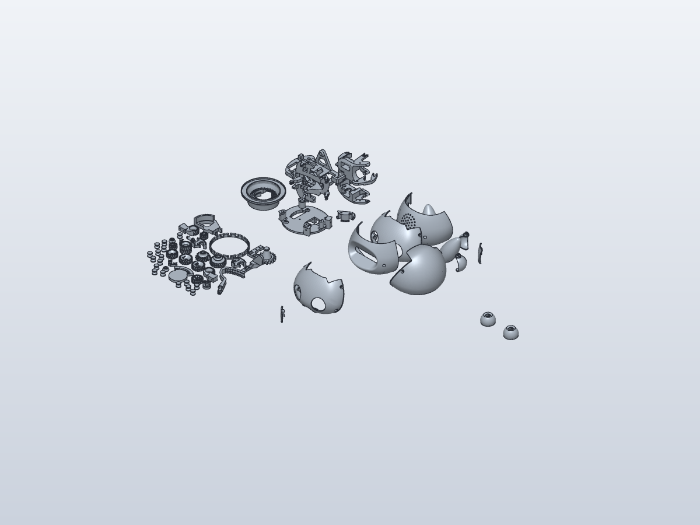

# Coglet build progress

Updated: 2026-11-10. This is a milestone record, not a live activity indicator.
Changes are local and uncommitted; nothing from this work has been pushed.

## Current checkpoint

Individual part separation and structural close-ups are complete. Functional
identification has begun; assembled positions and editable reconstruction remain.
The first editable SolidCraft sizing coupon is complete, with STL/STEP exports:
[diameter screening coupon and procedure](../hardware/mechanical/SIZING-COUPON.md).
No CAD reconstruction process is running in the background at this checkpoint.
The owner confirmed MG90S servos and reported two spline sizes. Horn types,
variant measurements and the intended XIAO board remain pending.
Further part identification can proceed independently; final
mounting and horn dimensions depend on those answers.

| Milestone | Status | Evidence / next action |
|---|---|---|
| Review builder readiness | Complete | [Findings](BUILD-REVIEW.md) |
| Set project license | Complete | CC BY-NC 4.0; root LICENSE and NOTICE.md preserve upstream and third-party notices |
| Select and retrieve upstream prints | Complete | C0_6_8, pinned revision, license and verified hashes in [source inventory](../hardware/mechanical/UPSTREAM.md) |
| Establish SolidCraft CLI/MCP support | Launcher verified | [Setup](SOLIDCRAFT.md); MCP initialization/tool discovery passed; chat client registration not done |
| Inventory print pack | Complete | [61 component occurrences on 5 plates](../hardware/mechanical/reference/INVENTORY.md) |
| Import SolidCraft reference | Complete | [48 grouped mesh bodies; triangle counts preserved](../hardware/mechanical/solidcraft/README.md) |
| Identify functional parts and assembly placement | In progress | 61 separate meshes verified; [six structural close-ups](../hardware/mechanical/reference/parts/STRUCTURAL-PARTS.md); assembled datums still needed |
| Recreate editable CAD | Not started | Begin with parts affected by electronics mounting |
| Servo sizing coupon | Ready for physical trial | 31 round bores, 3.0–6.0 mm; editable SolidCraft source and checked STL/STEP exports; no toothed interface yet |
| Design carrier installation and horn adaptations | Not started | Dimensions and component variants required before finalizing |
| Reconcile carrier generated outputs | Fixed | False stale warnings caused by Windows text encoding; generator now uses UTF-8 explicitly |
| Write illustrated installation sequence | Not started | Use verified CAD views and physical build photos |
| Physical build and second-builder validation | Not started | Record observed results only |

## Latest visible result

This is the imported print layout, not an assembled or modified robot:

## Next owner input

MG90S is confirmed; see [servo interface requirements](../hardware/mechanical/SERVO-INTERFACES.md).
The owner also uses KPower M0090. Next: print and try the diameter coupon on
each sample separately, then report smallest free-fit hole and printer settings.
Before finalizing horn interfaces and carrier mounting, collect the two spline
variants' dimensions, horn types, electronics variants and existing modifications.
First prepare annotated views showing precisely what needs measuring.

## Update convention

During active work, post short chat updates explaining the current operation,
new findings and any blocker. Update this file at each meaningful checkpoint,
link new artifacts, and clearly distinguish completed work from queued work.
Do not mark physical verification complete from software checks.
