# Step-by-step: the Coglet carrier board

> **Design, matched to a prototype in progress.** The XIAO's and amp's positions and the mic's and PCA9685's signal wires follow a board being built; the underside links and the power wire holes are the design's. The layout is checked by computer (the nets, the link routes) but not on a bench. This page is generated by [`tools/carrier/carrier.py`](../tools/carrier/carrier.py); don't edit it by hand.

The [hole map](../web-programmer/carrier/hole-map.svg) and [CARRIER.md](CARRIER.md) show the whole board at once; this page takes it one step at a time. Hole names are the **component side's**. The underside print on this board is **mirrored**: wherever you work from underneath, the guide gives the printed name too.

## Step 1: Prepare the modules

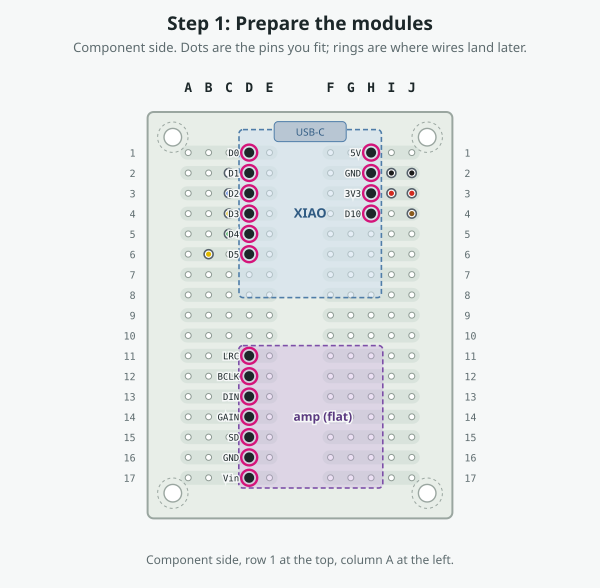

**Do this:**

1. **XIAO:** fit header pins to left row D0–D5 and right row 5V, GND, 3V3, D10 only. Leave **D6, D7, D8 and D9 out**, so their strips stay free. Fit the pins to the module with the perfboard as the jig, so they come out square, and solder them to the module only.
2. **MAX98357A amp:** a straight 7-pin header, all seven kept: Vin, GND, SD, GAIN, DIN, BCLK, LRC. It lies flat on the carrier.
3. **INMP441 mic:** solder its five 75 mm wires to the mic (white SCK, blue WS, yellow SD, red VDD, black GND) and tie **L/R to GND** on the mic board. That is wire J1 in the [wiring guide](wiring.html).
4. **PCA9685:** solder its five 90 mm wires to the breakout (green SDA, yellow SCL, red VCC, black GND, brown /OE), and swap its /OE pull-down for a pull-up as in the [wiring guide](wiring.html), stage 1.
5. Keep the four corner holes (A1, J1, A17, J17) empty: the mounting screws and their supports cover them.

- **Board:** ElectroCookie mini solderable breadboard, 38.1 × 50.8 mm, 17 rows
- **Check:** Hold each header over the hole map: every fitted pin lands on a dotted hole.
- **Check:** Nothing is soldered to the carrier yet.
- **Check:** Meter between L/R and GND on the mic: continuity.

## Step 2: L1, green, F3 → F11

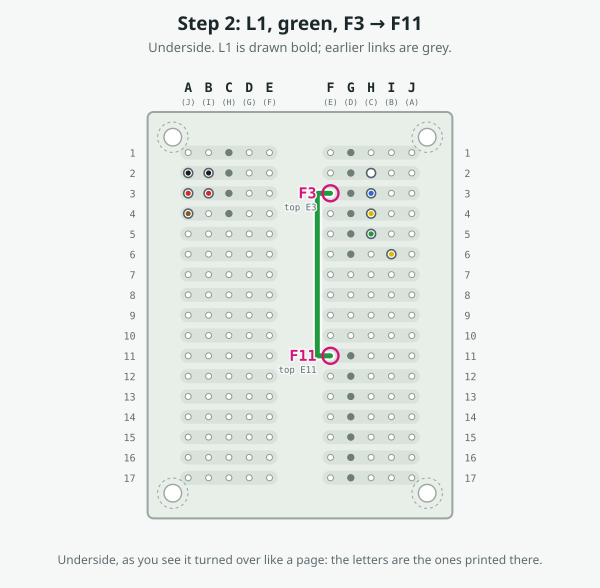

**Do this:**

1. Turn the board over (underside up).
2. Start at hole printed **F3** (top E3): push the tinned end in and solder it.
3. Lay the wire flat along the drawn path; pinch the corners and hold them with Kapton tape.
4. End at hole printed **F11** (top E11): push it in and solder it.
5. Turn the board back over and trim the ends in E3 and E11 flush: the XIAO and the amp sits over them.
6. Check, as below.

- **Wire:** L1, green, 30 AWG stranded
- **Cut:** 40 mm, estimated from the drawn route: trim to fit
- **From → to:** E3 → E11 (printed F3 → F11 on the underside)
- **Side:** underside (link)
- **What it does:** I2S word select: D2's strip to the amp's LRC.
- **Check:** E3 connects to E11. Both strips will join INMP441.WS, XIAO.D2, MAX98357A.LRC.
- **Check:** It must not connect to: INMP441.SCK (strip 2L), XIAO.D1 (strip 2L), INMP441.SD (strip 4L), XIAO.D3 (strip 4L), MAX98357A.BCLK (strip 12L)

## Step 3: L2, yellow, F2 → F12

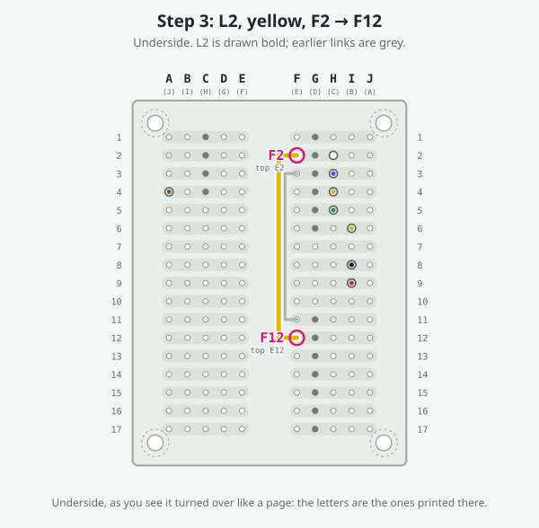

**Do this:**

1. Turn the board over (underside up).
2. Start at hole printed **F2** (top E2): push the tinned end in and solder it.
3. Lay the wire flat along the drawn path; pinch the corners and hold them with Kapton tape.
4. End at hole printed **F12** (top E12): push it in and solder it.
5. Turn the board back over and trim the ends in E2 and E12 flush: the XIAO and the amp sits over them.
6. Check, as below.

- **Wire:** L2, yellow, 30 AWG stranded
- **Cut:** 50 mm, estimated from the drawn route: trim to fit
- **From → to:** E2 → E12 (printed F2 → F12 on the underside)
- **Side:** underside (link)
- **What it does:** I2S bit clock: D1's strip to the amp's BCLK.
- **Check:** E2 connects to E12. Both strips will join INMP441.SCK, XIAO.D1, MAX98357A.BCLK.
- **Check:** It must not connect to: XIAO.D0 (strip 1L), INMP441.WS (strip 3L), XIAO.D2 (strip 3L), MAX98357A.LRC (strip 11L), MAX98357A.DIN (strip 13L)

## Step 4: L3, white, F1 → F13

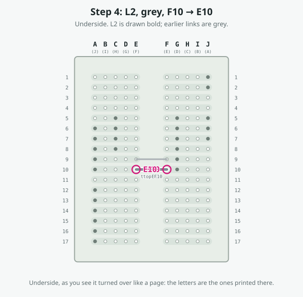

**Do this:**

1. Turn the board over (underside up).
2. Start at hole printed **F1** (top E1): push the tinned end in and solder it.
3. Lay the wire flat along the drawn path; pinch the corners and hold them with Kapton tape.
4. End at hole printed **F13** (top E13): push it in and solder it.
5. Turn the board back over and trim the ends in E1 and E13 flush: the XIAO and the amp sits over them.
6. Check, as below.

- **Wire:** L3, white, 30 AWG stranded
- **Cut:** 55 mm, estimated from the drawn route: trim to fit
- **From → to:** E1 → E13 (printed F1 → F13 on the underside)
- **Side:** underside (link)
- **What it does:** Speaker data: D0's strip to the amp's DIN.
- **Check:** E1 connects to E13. Both strips will join XIAO.D0, MAX98357A.DIN.
- **Check:** It must not connect to: INMP441.SCK (strip 2L), XIAO.D1 (strip 2L), MAX98357A.BCLK (strip 12L), MAX98357A.GAIN (strip 14L)

## Step 5: L4, red, E1 → F17

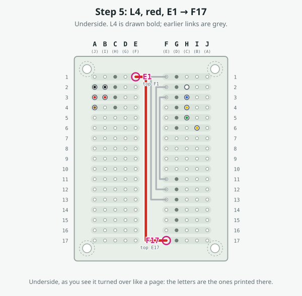

**Do this:**

1. Turn the board over (underside up).
2. Start at hole printed **E1** (top F1): push the tinned end in and solder it.
3. Lay the wire flat along the drawn path; pinch the corners and hold them with Kapton tape.
4. End at hole printed **F17** (top E17): push it in and solder it.
5. Turn the board back over and trim the ends in F1 and E17 flush: the XIAO and the amp sits over them.
6. Check, as below.

- **Wire:** L4, red, 30 AWG stranded
- **Cut:** 70 mm, estimated from the drawn route: trim to fit
- **From → to:** F1 → E17 (printed E1 → F17 on the underside)
- **Side:** underside (link)
- **What it does:** +5 V from the XIAO's 5V strip to the amp's Vin.
- **Check:** F1 connects to E17. Both strips will join XIAO.5V, MAX98357A.Vin.
- **Check:** It must not connect to: XIAO.GND (strip 2R), MAX98357A.GND (strip 16L)

## Step 6: L5, black, E2 → F16

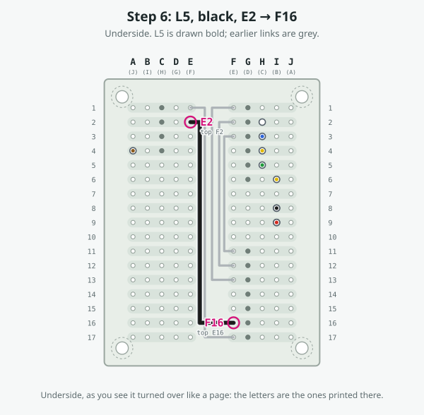

**Do this:**

1. Turn the board over (underside up).
2. Start at hole printed **E2** (top F2): push the tinned end in and solder it.
3. Lay the wire flat along the drawn path; pinch the corners and hold them with Kapton tape.
4. End at hole printed **F16** (top E16): push it in and solder it.
5. Turn the board back over and trim the ends in F2 and E16 flush: the XIAO and the amp sits over them.
6. Check, as below.

- **Wire:** L5, black, 30 AWG stranded
- **Cut:** 60 mm, estimated from the drawn route: trim to fit
- **From → to:** F2 → E16 (printed E2 → F16 on the underside)
- **Side:** underside (link)
- **What it does:** Ground from the XIAO's GND strip to the amp's GND.
- **Check:** F2 connects to E16. Both strips will join XIAO.GND, MAX98357A.GND.
- **Check:** It must not connect to: XIAO.5V (strip 1R), XIAO.3V3 (strip 3R), MAX98357A.SD (strip 15L), MAX98357A.Vin (strip 17L)

## Step 7: L6, red, H14 → H17

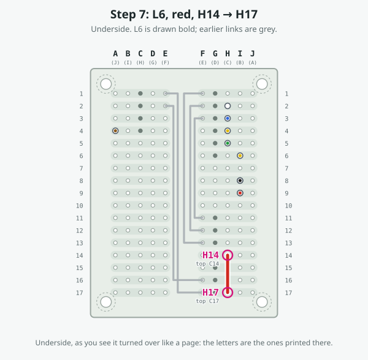

**Do this:**

1. Turn the board over (underside up).
2. Start at hole printed **H14** (top C14): push the tinned end in and solder it.
3. Lay the wire flat along the drawn path; pinch the corners and hold them with Kapton tape.
4. End at hole printed **H17** (top C17): push it in and solder it.
5. Check, as below.

- **Wire:** L6, red, 30 AWG stranded
- **Cut:** 20 mm, estimated from the drawn route: trim to fit
- **From → to:** C14 → C17 (printed H14 → H17 on the underside)
- **Side:** underside (link)
- **What it does:** Ties the amp's GAIN to its Vin (+5 V): 6 dB. This is wire J2 in the wire list.
- **Check:** C14 connects to C17. Both strips will join MAX98357A.GAIN, MAX98357A.Vin.
- **Check:** It must not connect to: MAX98357A.DIN (strip 13L), MAX98357A.SD (strip 15L), MAX98357A.GND (strip 16L)

## Step 8: Power rails: four jumpers

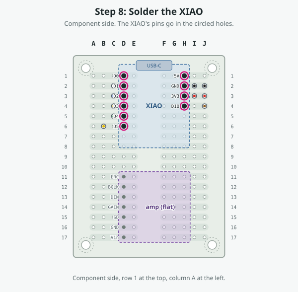

**Do this:**

1. These go on the **component side**, before the XIAO: H8 sits under the edge of its body.
2. **T1: I2 → H8; T2: I3 → H9; T3: E8 → F8; T4: E9 → F9**.
3. T1 and T2 bring ground and 3.3 V down the right half to rows 8 and 9; T3 and T4 carry both rails across the channel. The mic's and the PCA9685's power wires land on these rails later.
4. Keep the jumpers low and clear of the holes around them.

- **T1:** I2 → H8, colour not recorded: Ground from the XIAO's GND strip (row 2) to row 8.
- **T2:** I3 → H9, colour not recorded: 3.3 V from the XIAO's 3V3 strip (row 3) to row 9.
- **T3:** E8 → F8, orange: Joins row 8 across the channel: a ground rail on both halves.
- **T4:** E9 → F9, orange: Joins row 9 across the channel: a 3.3 V rail on both halves.
- **Check:** Row 8 (any hole, A–J) connects to H2's strip (GND); row 9 connects to H3's strip (3V3).
- **Check:** Row 9 must **not** connect to row 1 (5V) or to row 8.

## Step 9: Solder the XIAO

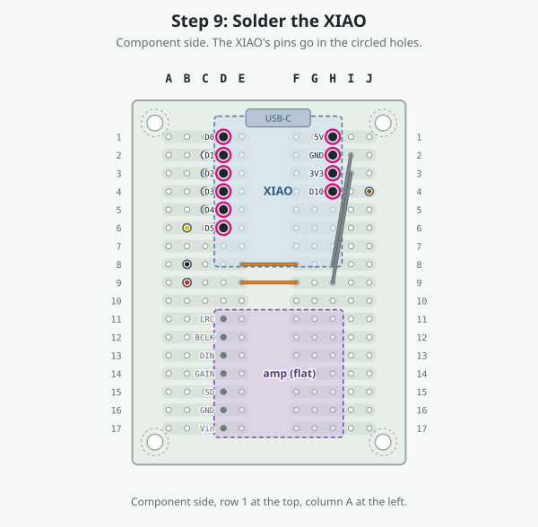

**Do this:**

1. Component side up, **USB-C toward row 1** (the top edge), so the port sits at the board's edge. Left pin row in column D (D0 at D1 … D5 at D6), right row in column H (5V at H1, GND H2, 3V3 H3, D10 at H4).
2. Solder each pin from the underside. Check the pins you pulled (D6–D9) are not in the board.
3. S3 Sense: the camera board stacks on top of the XIAO, so allow height above it.

- **Pins:** D0 D1, D1 D2, D2 D3, D3 D4, D4 D5, D5 D6, 5V H1, GND H2, 3V3 H3, D10 H4
- **USB-C:** Seeed's land pattern puts pin 1 2.9 mm from the body's USB end, so the body ends about 2.2 mm inside the board's row-1 edge. The cable plugs in from that edge.
- **Check:** Each XIAO pin hole reads the same net as its link end (see the continuity check below).

## Step 10: Solder the amp, flat

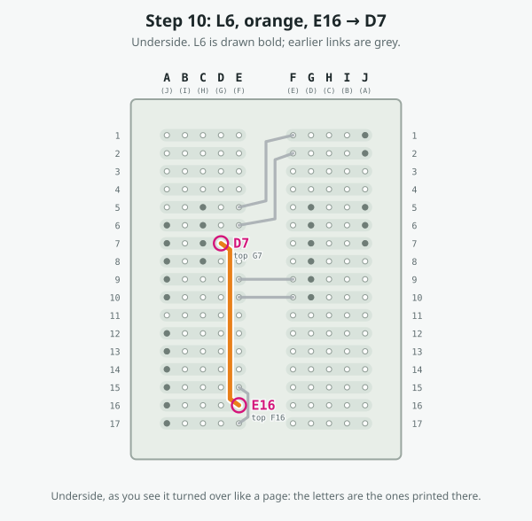

**Do this:**

1. Lay the MAX98357A flat on its straight header, pins in column D: **Vin D17, GND D16, SD D15, GAIN D14, DIN D13, BCLK D12, LRC D11**. Its board lies over the pins and toward column J, the speaker terminal at the far edge.
2. Solder from the underside. SD's strip (row 15, A–E) holds nothing else: SD stays unconnected. GAIN's strip is tied to Vin by L6, which sets 6 dB.
3. The speaker's two wires go to the amp's own terminal later.

- **Pins:** Vin D17, GND D16, SD D15, GAIN D14, DIN D13, BCLK D12, LRC D11
- **Check:** D17 connects to H1 (+5 V), D16 to H2 (GND) and D14 to D17 (GAIN to Vin).
- **Check:** D13, D12 and D11 connect to D1, D2 and D3 (the XIAO's D0, D1 and D2) through L3, L2 and L1.
- **Check:** D15 (SD) connects to nothing.

## Step 11: Solder the mic's wires

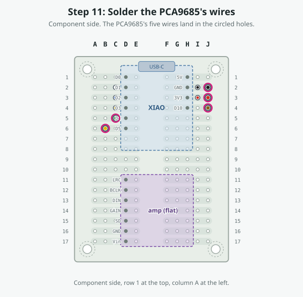

**Do this:**

1. The mic sits off the board, on its 75 mm wires, where the head has a sound opening. Each wire lands in the strip of the XIAO pin it needs, so it needs no link.
2. Push each wire in from the component side and solder it underneath: **SCK (white) C2, WS (blue) C3, SD (yellow) C4, GND (black) B8, VDD (red) B9**.
3. Red VDD goes on the row-9 rail (3.3 V) and black GND on the row-8 rail. Never on row 1, which is 5 V.
4. B8 and B9 each take two wires, the mic's and the PCA9685's: twist the two tinned ends together, push them in and solder them as one.

- **Wires:** SCK (white) C2, WS (blue) C3, SD (yellow) C4, GND (black) B8, VDD (red) B9
- **Check:** C2 connects to D2 (D1, bit clock), C3 to D3 (D2, word select), C4 to D4 (D3, mic data).
- **Check:** B9 connects to H3 (3V3) and B8 to H2 (GND).

## Step 12: Solder the PCA9685's wires

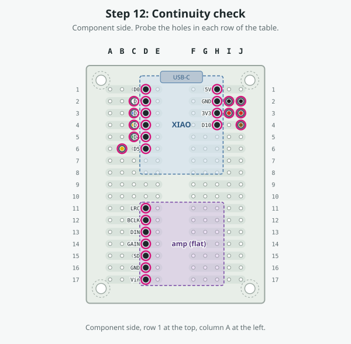

**Do this:**

1. The PCA9685 sits off the board, on its 90 mm wires. Each wire lands in the strip of the XIAO pin it needs, so it needs no link.
2. Push each wire in from the component side and solder it underneath: **SDA (green) C5, SCL (yellow) B6, GND (black) B8, VCC (red) B9, /OE (brown) J4**.
3. Red VCC is the logic supply: the row-9 rail (3.3 V), not 5 V. Black GND goes on the row-8 rail. The servo supply never comes to the carrier.
4. The /OE pull-up (about 10 kΩ to VCC) sits on the PCA9685 board itself.

- **Wires:** SDA (green) C5, SCL (yellow) B6, GND (black) B8, VCC (red) B9, /OE (brown) J4
- **Check:** C5 connects to D5 (SDA, D4) and B6 to D6 (SCL, D5).
- **Check:** B8 connects to H2 (GND), B9 to H3 (3V3) and J4 to H4 (D10).

## Step 13: Continuity check

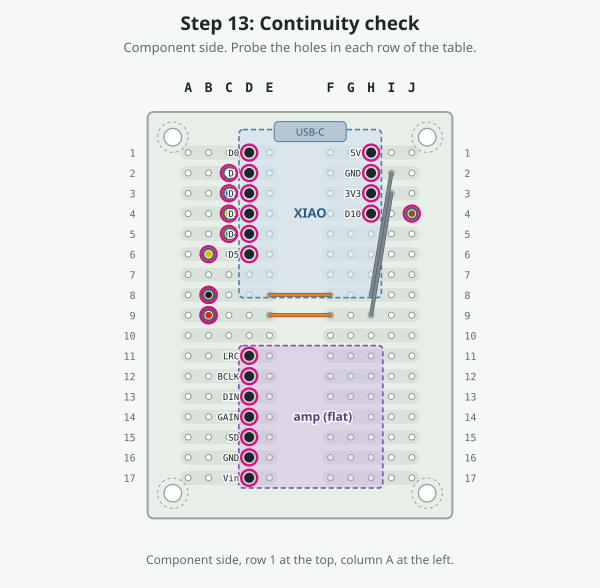

**Do this:**

1. Meter on continuity: connected beeps. Probe from the component side.

| Net | Holes that must connect |
|---|---|
| +3V3 | B9 (mic.VDD), B9 (PCA lead.VCC), H3 (XIAO.3V3) |
| +5V | D14 (amp.GAIN), D17 (amp.Vin), H1 (XIAO.5V) |
| GND | B8 (mic.GND), B8 (PCA lead.GND), D16 (amp.GND), H2 (XIAO.GND) |
| D0 | D1 (XIAO.D0), D13 (amp.DIN) |
| D1 | C2 (mic.SCK), D2 (XIAO.D1), D12 (amp.BCLK) |
| D2 | C3 (mic.WS), D3 (XIAO.D2), D11 (amp.LRC) |
| D3 | C4 (mic.SD), D4 (XIAO.D3) |
| D4 | C5 (PCA lead.SDA), D5 (XIAO.D4) |
| D5 | B6 (PCA lead.SCL), D6 (XIAO.D5) |
| D10 | H4 (XIAO.D10), J4 (PCA lead./OE) |

Then check that these nets are **not** connected to each other: +3V3, +5V and GND against every other net and each other, and D1 against D2.

## Step 14: Off the board

**Do this:**

1. Speaker: its two wires to the amp's own screw terminal (+ and −).
2. Servo power stays off the carrier: the supply's + goes through the switch to the PCA9685's V+ terminal, and its − to the PCA9685's GND terminal, as in stage 8 of the [wiring guide](wiring.html).
3. Leave the switch off and every servo unplugged.

| Wire | Hole | Lead | Colour |
|---|---|---|---|
| mic SCK | C2 | 75 mm | white |
| mic WS | C3 | 75 mm | blue |
| mic SD | C4 | 75 mm | yellow |
| mic GND | B8 | 75 mm | black |
| mic VDD | B9 | 75 mm | red |
| PCA9685 SDA | C5 | 90 mm | green |
| PCA9685 SCL | B6 | 90 mm | yellow |
| PCA9685 GND | B8 | 90 mm | black |
| PCA9685 VCC | B9 | 90 mm | red |
| PCA9685 /OE | J4 | 90 mm, hole chosen by the design | brown |

- **Check:** Then run the bench checks on the [Check](console.html) page.

