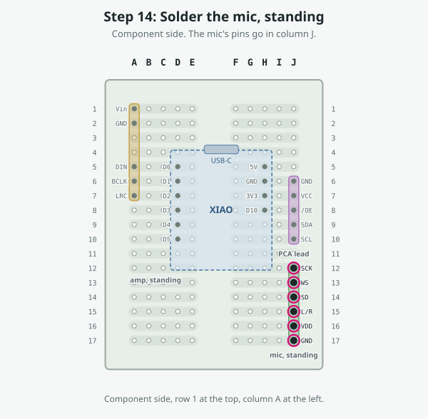
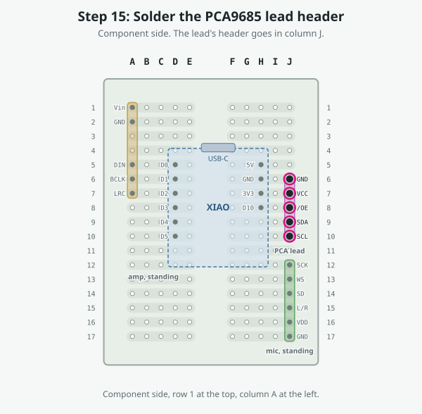
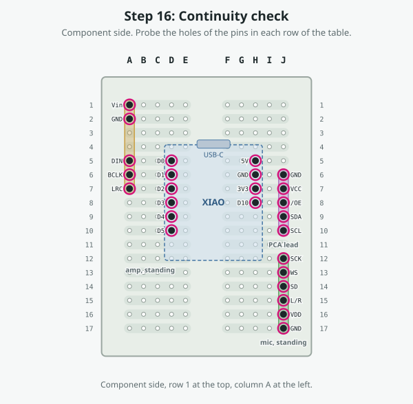

# Step-by-step: the Coglet carrier board

> **Design, not yet built.** Nobody has assembled this board. The layout is checked by computer (the nets, the link routes) but not on a bench, and the amp's and mic's pin orders are assumed. This page is generated by [`tools/carrier/carrier.py`](../tools/carrier/carrier.py); don't edit it by hand.

The [hole map](../web-programmer/carrier/hole-map.svg) and [CARRIER.md](CARRIER.md) show the whole board at once; this page takes it one step at a time. Hole names are the **component side's**. The underside print on this board is **mirrored**: wherever you work from underneath, the guide gives the printed name too.

## Step 1: Prepare the modules

**Do this:**

1. Fit header pins **only where the hole map shows a dot**, and pull the others out with pliers. Each strip that has no pin in it stays free for links.
2. **XIAO:** left row D0–D5, right row 5V, GND, 3V3, D10. Leave **D6, D7, D8 and D9 out**. Fit the pins to the module with the perfboard as the jig, so they come out square, and solder them to the module only.
3. **MAX98357A amp:** a 7-pin header on its pin edge, keeping Vin, GND, DIN, BCLK and LRC. Pull SD and GAIN. *Assumed pin order Vin, GND, SD, GAIN, DIN, BCLK, LRC: check your board's labels.*
4. **INMP441 mic:** a 6-pin header, all six kept. *Assumed pin order SCK, WS, SD, L/R, VDD, GND: check your board's labels. If yours differs, keep the same nets and move the pins and links to suit.*
5. **PCA9685 lead:** a 5-pin header in the order GND, VCC, /OE, SDA, SCL.
6. **PCA9685 /OE:** swap the breakout's pull-down for a pull-up as in the [wiring guide](wiring.html), stage 1.

- **Board:** ElectroCookie mini solderable breadboard, 38.1 × 50.8 mm, 17 rows
- **Check:** Hold each header over the hole map: every fitted pin lands on a dotted hole.
- **Check:** Nothing is soldered to the carrier yet.

## Step 2: L3, black, E15 → E17

**Do this:**

1. Turn the board over (underside up).
2. Start at hole printed **E15** (top F15): push the tinned end in and solder it.
3. Lay the wire flat along the drawn path; pinch the corners and hold them with Kapton tape.
4. End at hole printed **E17** (top F17): push it in and solder it.
5. Check, as below.

- **Wire:** L3, black, 30 AWG stranded
- **Cut:** 20 mm, estimated from the drawn route: trim to fit
- **From → to:** F15 → F17 (printed E15 → E17 on the underside)
- **Side:** underside (link)
- **What it does:** Ties the mic's L/R pin to its GND pin, so it drives the left slot.
- **Check:** F15 connects to F17. Both strips will join INMP441.L/R, INMP441.GND.
- **Check:** It must not connect to: INMP441.SD (strip 14R), INMP441.VDD (strip 16R)

## Step 3: L1, violet, F9 → E9

**Do this:**

1. Turn the board over (underside up).
2. Start at hole printed **F9** (top E9): push the tinned end in and solder it.
3. Lay the wire flat along the drawn path; pinch the corners and hold them with Kapton tape.
4. End at hole printed **E9** (top F9): push it in and solder it.
5. Check, as below.

- **Wire:** L1, violet, 30 AWG stranded
- **Cut:** 20 mm, estimated from the drawn route: trim to fit
- **From → to:** E9 → F9 (printed F9 → E9 on the underside)
- **Side:** underside (link)
- **What it does:** SDA: D4's strip to the lead's SDA pin.
- **Check:** E9 connects to F9. Both strips will join XIAO.D4, PCA9685.SDA.
- **Check:** It must not connect to: XIAO.D3 (strip 8L), XIAO.D5 (strip 10L), PCA9685./OE (strip 8R), XIAO.D10 (strip 8R), PCA9685.SCL (strip 10R)

## Step 4: L2, grey, F10 → E10

**Do this:**

1. Turn the board over (underside up).
2. Start at hole printed **F10** (top E10): push the tinned end in and solder it.
3. Lay the wire flat along the drawn path; pinch the corners and hold them with Kapton tape.
4. End at hole printed **E10** (top F10): push it in and solder it.
5. Check, as below.

- **Wire:** L2, grey, 30 AWG stranded
- **Cut:** 20 mm, estimated from the drawn route: trim to fit
- **From → to:** E10 → F10 (printed F10 → E10 on the underside)
- **Side:** underside (link)
- **What it does:** SCL: D5's strip to the lead's SCL pin.
- **Check:** E10 connects to F10. Both strips will join XIAO.D5, PCA9685.SCL.
- **Check:** It must not connect to: XIAO.D4 (strip 9L), PCA9685.SDA (strip 9R)

## Step 5: L4, red, F1 → E5

**Do this:**

1. Turn the board over (underside up).
2. Start at hole printed **F1** (top E1): push the tinned end in and solder it.
3. Lay the wire flat along the drawn path; pinch the corners and hold them with Kapton tape.
4. End at hole printed **E5** (top F5): push it in and solder it.
5. Check, as below.

- **Wire:** L4, red, 30 AWG stranded
- **Cut:** 30 mm, estimated from the drawn route: trim to fit
- **From → to:** E1 → F5 (printed F1 → E5 on the underside)
- **Side:** underside (link)
- **What it does:** +5 V from the XIAO's 5V strip to the amp's Vin.
- **Check:** E1 connects to F5. Both strips will join MAX98357A.Vin, XIAO.5V.
- **Check:** It must not connect to: MAX98357A.GND (strip 2L), PCA9685.GND (strip 6R), XIAO.GND (strip 6R)

## Step 6: L5, black, F2 → E6

**Do this:**

1. Turn the board over (underside up).
2. Start at hole printed **F2** (top E2): push the tinned end in and solder it.
3. Lay the wire flat along the drawn path; pinch the corners and hold them with Kapton tape.
4. End at hole printed **E6** (top F6): push it in and solder it.
5. Check, as below.

- **Wire:** L5, black, 30 AWG stranded
- **Cut:** 30 mm, estimated from the drawn route: trim to fit
- **From → to:** E2 → F6 (printed F2 → E6 on the underside)
- **Side:** underside (link)
- **What it does:** Ground from the XIAO's GND strip to the amp's GND.
- **Check:** E2 connects to F6. Both strips will join MAX98357A.GND, PCA9685.GND, XIAO.GND.
- **Check:** It must not connect to: MAX98357A.Vin (strip 1L), XIAO.5V (strip 5R), PCA9685.VCC (strip 7R), XIAO.3V3 (strip 7R)

## Step 7: L9, green, F7 → E13

**Do this:**

1. Turn the board over (underside up).
2. Start at hole printed **F7** (top E7): push the tinned end in and solder it.
3. Lay the wire flat along the drawn path; pinch the corners and hold them with Kapton tape.
4. End at hole printed **E13** (top F13): push it in and solder it.
5. Check, as below.

- **Wire:** L9, green, 30 AWG stranded
- **Cut:** 35 mm, estimated from the drawn route: trim to fit
- **From → to:** E7 → F13 (printed F7 → E13 on the underside)
- **Side:** underside (link)
- **What it does:** I2S word select: D2's strip (the amp's LRC) to the mic's WS.
- **Check:** E7 connects to F13. Both strips will join MAX98357A.LRC, XIAO.D2, INMP441.WS.
- **Check:** It must not connect to: MAX98357A.BCLK (strip 6L), XIAO.D1 (strip 6L), XIAO.D3 (strip 8L), INMP441.SCK (strip 12R), INMP441.SD (strip 14R)

## Step 8: L10, blue, F8 → E14

**Do this:**

1. Turn the board over (underside up).
2. Start at hole printed **F8** (top E8): push the tinned end in and solder it.
3. Lay the wire flat along the drawn path; pinch the corners and hold them with Kapton tape.
4. End at hole printed **E14** (top F14): push it in and solder it.
5. Check, as below.

- **Wire:** L10, blue, 30 AWG stranded
- **Cut:** 35 mm, estimated from the drawn route: trim to fit
- **From → to:** E8 → F14 (printed F8 → E14 on the underside)
- **Side:** underside (link)
- **What it does:** Mic data: D3's strip to the mic's SD.
- **Check:** E8 connects to F14. Both strips will join XIAO.D3, INMP441.SD.
- **Check:** It must not connect to: MAX98357A.LRC (strip 7L), XIAO.D2 (strip 7L), XIAO.D4 (strip 9L), INMP441.WS (strip 13R), INMP441.L/R (strip 15R)

## Step 9: L8, yellow, F6 → E12

**Do this:**

1. Turn the board over (underside up).
2. Start at hole printed **F6** (top E6): push the tinned end in and solder it.
3. Lay the wire flat along the drawn path; pinch the corners and hold them with Kapton tape.
4. End at hole printed **E12** (top F12): push it in and solder it.
5. Check, as below.

- **Wire:** L8, yellow, 30 AWG stranded
- **Cut:** 35 mm, estimated from the drawn route: trim to fit
- **From → to:** E6 → F12 (printed F6 → E12 on the underside)
- **Side:** underside (link)
- **What it does:** I2S bit clock: D1's strip (the amp's BCLK) to the mic's SCK.
- **Check:** E6 connects to F12. Both strips will join MAX98357A.BCLK, XIAO.D1, INMP441.SCK.
- **Check:** It must not connect to: MAX98357A.DIN (strip 5L), XIAO.D0 (strip 5L), MAX98357A.LRC (strip 7L), XIAO.D2 (strip 7L), INMP441.WS (strip 13R)

## Step 10: L6, orange, E16 → D7

**Do this:**

1. Turn the board over (underside up).
2. Start at hole printed **E16** (top F16): push the tinned end in and solder it.
3. Lay the wire flat along the drawn path; pinch the corners and hold them with Kapton tape.
4. End at hole printed **D7** (top G7): push it in and solder it.
5. Check, as below.

- **Wire:** L6, orange, 30 AWG stranded
- **Cut:** 40 mm, estimated from the drawn route: trim to fit
- **From → to:** F16 → G7 (printed E16 → D7 on the underside)
- **Side:** underside (link)
- **What it does:** 3.3 V from the XIAO's 3V3 strip to the mic's VDD.
- **Check:** F16 connects to G7. Both strips will join INMP441.VDD, PCA9685.VCC, XIAO.3V3.
- **Check:** It must not connect to: INMP441.L/R (strip 15R), INMP441.GND (strip 17R), PCA9685.GND (strip 6R), XIAO.GND (strip 6R), PCA9685./OE (strip 8R), XIAO.D10 (strip 8R)

## Step 11: L7, black, D17 → D6

**Do this:**

1. Turn the board over (underside up).
2. Start at hole printed **D17** (top G17): push the tinned end in and solder it.
3. Lay the wire flat along the drawn path; pinch the corners and hold them with Kapton tape.
4. End at hole printed **D6** (top G6): push it in and solder it.
5. Check, as below.

- **Wire:** L7, black, 30 AWG stranded
- **Cut:** 45 mm, estimated from the drawn route: trim to fit
- **From → to:** G17 → G6 (printed D17 → D6 on the underside)
- **Side:** underside (link)
- **What it does:** Ground from the XIAO's GND strip to the mic's GND.
- **Check:** G17 connects to G6. Both strips will join INMP441.GND, PCA9685.GND, XIAO.GND.
- **Check:** It must not connect to: INMP441.VDD (strip 16R), XIAO.5V (strip 5R), PCA9685.VCC (strip 7R), XIAO.3V3 (strip 7R)

## Step 12: Solder the XIAO

**Do this:**

1. Component side up, **USB-C toward row 1** (the top edge). Left pin row in column D (D0 at D5 … D5 at D10), right row in column H (5V at H5, GND, 3V3, D10 at H8).
2. Solder each pin from the underside. Check the pins you pulled (D6–D9) are not in the board.
3. S3 Sense: the camera board stacks on top of the XIAO, so allow height above it.

- **Pins:** D0 D5, D1 D6, D2 D7, D3 D8, D4 D9, D5 D10, 5V H5, GND H6, 3V3 H7, D10 H8
- **Check:** Each XIAO pin hole reads the same net as its link end (see the continuity check below).

## Step 13: Solder the amp, standing

**Do this:**

1. Stand the MAX98357A on its header in column A, rows 1–7, its board edge-on to the board and the pin edge down. Vin at A1, GND at A2, DIN at A5, BCLK at A6, LRC at A7. SD and GAIN (A3, A4) have no pin.
2. Solder from the underside. The speaker's two wires go to the amp's own terminal later.

- **Pins:** Vin A1, GND A2, DIN A5, BCLK A6, LRC A7
- **Assumed:** the amp's pin order; check your board
- **Check:** A5, A6 and A7 are already joined to D0, D1 and D2 by their strips.

## Step 14: Solder the mic, standing

**Do this:**

1. Stand the INMP441 on its header in column J, rows 12–17: SCK J12, WS J13, SD J14, L/R J15, VDD J16, GND J17. Its sound port should face where the mechanism will have an opening; that is not designed yet.
2. Solder from the underside.

- **Pins:** SCK J12, WS J13, SD J14, L/R J15, VDD J16, GND J17
- **Assumed:** the mic's pin order; check your board
- **Check:** Mic placement is flagged open: its position depends on the mechanical design.

## Step 15: Solder the PCA9685 lead header

**Do this:**

1. Stand the 5-pin header in column J, rows 6–10, in the order GND (J6), VCC (J7), /OE (J8), SDA (J9), SCL (J10).
2. Solder from the underside. GND, VCC and /OE already sit in the strips of the XIAO's GND, 3V3 and D10; SDA and SCL were joined by L1 and L2.

- **Pins:** GND J6, VCC J7, /OE J8, SDA J9, SCL J10
- **Check:** J6 reads as ground, J7 as 3.3 V, J8 as D10.

## Step 16: Continuity check

**Do this:**

1. Meter on continuity: connected beeps. Probe from the component side.

| Net | Holes that must connect |
|---|---|
| +3V3 | H7 (XIAO.3V3), J7 (PCA lead.VCC), J16 (mic.VDD) |
| +5V | A1 (amp.Vin), H5 (XIAO.5V) |
| GND | A2 (amp.GND), H6 (XIAO.GND), J6 (PCA lead.GND), J15 (mic.L/R), J17 (mic.GND) |
| D0 | A5 (amp.DIN), D5 (XIAO.D0) |
| D1 | A6 (amp.BCLK), D6 (XIAO.D1), J12 (mic.SCK) |
| D2 | A7 (amp.LRC), D7 (XIAO.D2), J13 (mic.WS) |
| D3 | D8 (XIAO.D3), J14 (mic.SD) |
| D4 | D9 (XIAO.D4), J9 (PCA lead.SDA) |
| D5 | D10 (XIAO.D5), J10 (PCA lead.SCL) |
| D10 | H8 (XIAO.D10), J8 (PCA lead./OE) |

Then check that these nets are **not** connected to each other: +3V3, +5V and GND against every other net and each other, and D1 against D2.

## Step 17: Leads off the board

**Do this:**

1. Make the PCA9685 lead: a 5-wire lead with a female 5-pin connector at the carrier end and the breakout's pin spacing at the other: GND, VCC, /OE, SDA, SCL in the carrier's order.
2. Speaker: its two wires to the amp's own screw terminal (+ and −).
3. Servo power stays off the carrier: the supply's + goes through the switch to the PCA9685's V+ terminal, and its − to the PCA9685's GND terminal, as in stage 8 of the [wiring guide](wiring.html).
4. Leave the switch off and every servo unplugged.

| Carrier pin | Hole | Goes to | Suggested colour |
|---|---|---|---|
| GND | J6 | PCA9685 GND | black |
| VCC | J7 | PCA9685 VCC | orange |
| /OE | J8 | PCA9685 /OE | brown |
| SDA | J9 | PCA9685 SDA | violet |
| SCL | J10 | PCA9685 SCL | grey |

- **Check:** Then run the bench checks on the [Check](console.html) page.

