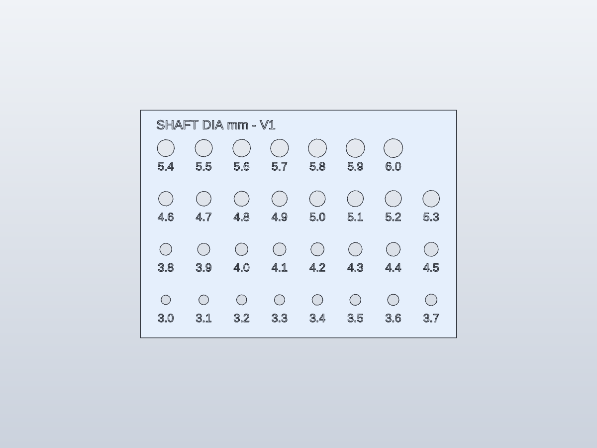

# Servo sizing coupon V1 — diameter screening

This first coupon screens shaft outside diameter and the fit produced by your
printer. It is **not a toothed spline socket, horn, or torque-transmitting part**.
Use it with the owner's MG90S variants and KPower M0090 samples separately.

## Files

- [Print STL](exports/servo-diameter-coupon.stl)
- [Editable SolidCraft design](solidcraft/servo-diameter-coupon.sc)
- [STEP](exports/servo-diameter-coupon.step)
- [Replayable command script](solidcraft/servo-diameter-coupon.json)
- [Hole layout and nominal sizes](solidcraft/servo-diameter-coupon-layout.json)

Plate: 100 × 72 × 2 mm. Thirty-one through-holes: 3.0 to 6.0 mm in 0.1 mm
increments. Diameters are engraved beneath their holes, 0.4 mm deep.
The range and plate dimensions are design choices, not measured servo data.
Labels follow the diameter parameters in SolidCraft. Changing a diameter also
requires checking spacing and wall thickness before printing.

## Print and use



Software checks: one closed body; 100 × 72 × 2 mm bounds; 31 nominal bores;
volume consistent with the bore cuts and engraving; exported STL edges each
have two incident triangles. Rendered labels were visually inspected. These
checks do not establish the printed holes' accuracy or physical fit.

1. Print flat, labels upward, at 100% scale, with no supports. Use the intended
   final part's material and printer settings. A 0.2 mm layer height is a starting
   choice for this 2 mm plate; verify label resolution in your slicer.
2. Record printer, nozzle, material, layer height and any XY/hole compensation.
   Measure the printed plate and representative holes with calipers if available.
   A labeled nominal bore is not a calibrated measurement of the shaft.
3. Disconnect the servo's power. Remove its horn only if accessible and retain
   its original screw and horn together with that servo.
4. Approach the shaft with a larger hole, then try smaller holes gently. Do not
   force a tight fit or turn the coupon against the servo's gearbox. If none
   fits freely, stop and measure the shaft before extending the test range.
5. Record the smallest hole that slips over the spline without force, the next
   smaller hole's result, and whether the plate reached the full exposed spline
   height or contacted the housing first. Record separate results for each unit.
6. Provide a close-up of the spline or its tooth count and the supplied horn
   style. Round holes alone cannot distinguish tooth counts, root diameters,
   screw threads or usable engagement depth.

## Result record

| Sample / supplier | Smallest free-fit label | Next smaller result | Measured shaft OD | Exposed height | Tooth count | Supplied horn |
|---|---|---|---|---|---|---|
| MG90S A | Pending | Pending | Pending | Pending | Pending | Pending |
| MG90S B | Pending | Pending | Pending | Pending | Pending | Pending |
| KPower M0090 | Pending | Pending | Pending | Pending | Pending | Pending |

Also record the printer settings above. No coupon has been printed or tested
physically by the agent. A 0.1 mm nominal increment does not promise 0.1 mm
accuracy from a particular printer.

## Next coupon

Once the samples are identified, make a smaller clearance series around the
observed fit. If using supplied horns, test the horn pocket and screw pattern.
If attaching directly to splines, obtain tooth count, major/minor diameters and
engagement geometry before creating toothed trials. Diameter-only fits do not
qualify either design for motion or load.

## Regenerate

```powershell
python tools/make_servo_coupon.py
./tools/solidcraft.ps1 run hardware/mechanical/solidcraft/servo-diameter-coupon.json --save hardware/mechanical/solidcraft/servo-diameter-coupon.sc --out hardware/mechanical/exports/servo-diameter-coupon.stl --out hardware/mechanical/exports/servo-diameter-coupon.step
```

Created with SolidCraft CLI 0.30.1. This coupon is newly constructed geometry;
it contains no mesh copied from the upstream Coglet print set.
