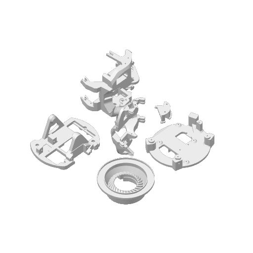
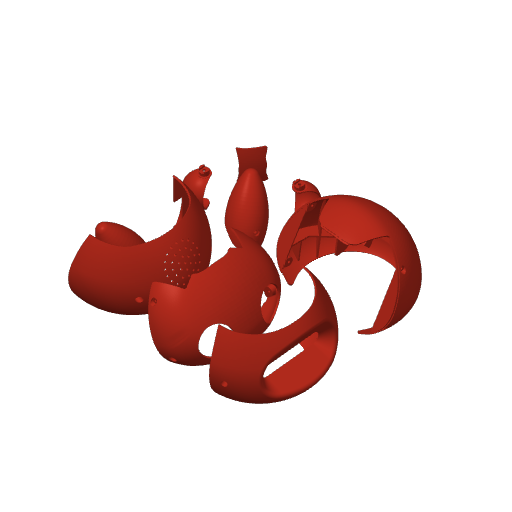
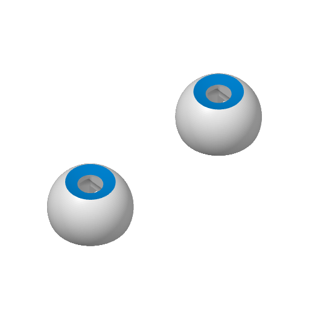
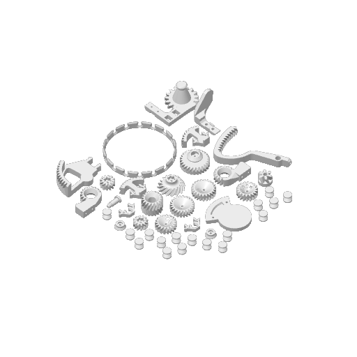

# C0_6_8 print-pack inventory

Generated by `python tools/inventory_coglet.py` from the pinned upstream 3MF.

5 plates, 61 component occurrences. These are not a robot BOM:
the pack includes alternative skins and repeated parts. Functional roles are unverified.
Dimensions are mesh-local bounding boxes in mm, not installed clearances.

Names and plate previews are upstream material by Will Cogley / NMRobotics LTD;
see [license](../original/LICENSE.upstream) and [provenance](../UPSTREAM.md).

## Plate 1: Unnamed upstream plate

| ID | Upstream name | Local X × Y × Z (mm) | Triangles |
|---|---|---|---|
| C068-O20-P14 | Full - BottomPlug.stl | 38.28 × 29.35 × 16.30 | 3996 |
| C068-O20-P15 | Full.stl_7 | 99.53 × 97.24 × 75.79 | 80412 |
| C068-O20-P16 | Full - Part 24.stl | 101.68 × 84.72 × 46.44 | 49706 |
| C068-O20-P17 | Full - Foot (1).stl | 92.00 × 92.00 × 27.75 | 100214 |
| C068-O20-P18 | Full (9).stl_3 | 105.82 × 96.00 × 33.85 | 27830 |
| C068-O20-P19 | Full (9).stl_2 | 110.96 × 80.81 × 46.00 | 20962 |

## Plate 2: Normal Skin

| ID | Upstream name | Local X × Y × Z (mm) | Triangles |
|---|---|---|---|
| C068-O13-P10 | Full (6).stl_2 | 130.25 × 58.91 × 79.75 | 56750 |
| C068-O13-P11 | NewPlainEars.stl_1 | 43.89 × 39.11 × 56.62 | 45504 |
| C068-O13-P12 | NewPlainEars.stl_2 | 43.91 × 39.11 × 56.62 | 45510 |
| C068-O13-P4 | Full.stl_48 | 129.15 × 61.53 × 81.54 | 101788 |
| C068-O13-P5 | Full.stl_20 | 129.59 × 81.03 × 90.58 | 42612 |
| C068-O13-P6 | Full.stl_30 | 42.01 × 26.81 × 23.89 | 25276 |
| C068-O13-P7 | Full.stl_38 | 22.17 × 20.00 × 35.27 | 9830 |
| C068-O13-P8 | Full.stl_65 | 42.01 × 26.81 × 23.89 | 25276 |
| C068-O13-P9 | Full (6).stl_1 | 131.69 × 73.29 × 80.19 | 87192 |

## Plate 3: Unnamed upstream plate

| ID | Upstream name | Local X × Y × Z (mm) | Triangles |
|---|---|---|---|
| C068-O2-P1 | Full.stl_32 | 32.00 × 18.64 × 32.00 | 21772 |
| C068-O3-P1 | Full.stl_32 | 32.00 × 18.64 × 32.00 | 21772 |

## Plate 4: Unnamed upstream plate

| ID | Upstream name | Local X × Y × Z (mm) | Triangles |
|---|---|---|---|
| C068-O100-P99 | Full (9).stl_1 | 24.94 × 26.41 × 43.03 | 34952 |
| C068-O102-P101 | Full (10).stl_1 | 31.66 × 30.00 × 15.00 | 11246 |
| C068-O104-P103 | Full (10).stl_2 | 31.66 × 29.00 × 15.00 | 11878 |
| C068-O22-P21 | Full (5).stl_1 | 31.82 × 39.37 × 57.00 | 17286 |
| C068-O24-P23 | Full (5).stl_2 | 33.92 × 35.75 × 29.00 | 4004 |
| C068-O26-P25 | Full.stl_35 | 82.40 × 82.40 × 9.02 | 26082 |
| C068-O28-P27 | Full.stl_58 | 10.00 × 85.25 × 56.12 | 8136 |
| C068-O30-P29 | Full.stl_8 | 59.35 × 20.00 × 39.41 | 14688 |
| C068-O32-P31 | Exterior - Eyelid.stl | 20.96 × 33.60 × 33.60 | 61260 |
| C068-O34-P33 | Full.stl_16 | 13.15 × 31.83 × 31.83 | 51658 |
| C068-O36-P35 | Full.stl_18 | 27.42 × 27.42 × 8.75 | 44342 |
| C068-O38-P37 | Full.stl_22 | 27.42 × 27.42 × 8.75 | 43462 |
| C068-O40-P39 | Full.stl_9 | 24.00 × 18.75 × 24.00 | 72132 |
| C068-O42-P41 | Full (4).stl_1 | 46.72 × 51.77 × 5.10 | 3116 |
| C068-O44-P43 | Full.stl_53 | 8.75 × 24.00 × 24.00 | 38200 |
| C068-O46-P45 | Full.stl_57 | 8.75 × 24.00 × 24.00 | 40108 |
| C068-O48-P47 | Full (3).stl_2 | 14.98 × 18.23 × 18.37 | 38404 |
| C068-O50-P49 | Full (3).stl_1 | 14.98 × 18.23 × 18.37 | 39300 |
| C068-O52-P51 | Full.stl_2 | 12.35 × 16.00 × 16.00 | 50840 |
| C068-O54-P53 | Full.stl_24 | 17.19 × 9.00 × 6.20 | 28190 |
| C068-O56-P55 | HeadMech - EarLock.stl | 10.03 × 12.39 × 12.41 | 2880 |
| C068-O58-P57 | HeadMech - EarLock.stl | 10.03 × 12.39 × 12.41 | 2880 |
| C068-O60-P59 | Full.stl_10 | 13.01 × 13.01 × 10.00 | 2016 |
| C068-O62-P61 | Full.stl_10 | 13.01 × 13.01 × 10.00 | 2016 |
| C068-O64-P63 | Full.stl_10 | 13.01 × 13.01 × 10.00 | 2016 |
| C068-O66-P65 | Full.stl_10 | 13.01 × 13.01 × 10.00 | 2016 |
| C068-O68-P67 | Full.stl_10 | 13.01 × 13.01 × 10.00 | 2016 |
| C068-O70-P69 | Full.stl_10 | 13.01 × 13.01 × 10.00 | 2016 |
| C068-O72-P71 | Full.stl_10 | 13.01 × 13.01 × 10.00 | 2016 |
| C068-O74-P73 | Full.stl_10 | 13.01 × 13.01 × 10.00 | 2016 |
| C068-O76-P75 | Full.stl_10 | 13.01 × 13.01 × 10.00 | 2016 |
| C068-O78-P77 | Full.stl_10 | 13.01 × 13.01 × 10.00 | 2016 |
| C068-O80-P79 | Full.stl_10 | 13.01 × 13.01 × 10.00 | 2016 |
| C068-O82-P81 | Full.stl_10 | 13.01 × 13.01 × 10.00 | 2016 |
| C068-O84-P83 | Full.stl_10 | 13.01 × 13.01 × 10.00 | 2016 |
| C068-O86-P85 | Full.stl_10 | 13.01 × 13.01 × 10.00 | 2016 |
| C068-O88-P87 | Full.stl_10 | 13.01 × 13.01 × 10.00 | 2016 |
| C068-O90-P89 | Full.stl_10 | 13.01 × 13.01 × 10.00 | 2016 |
| C068-O92-P91 | Full.stl_10 | 13.01 × 13.01 × 10.00 | 2016 |
| C068-O94-P93 | Full - EyeAdaptorR.stl | 24.00 × 14.05 × 4.70 | 3288 |
| C068-O96-P95 | Full - EyeAdaptorR.stl | 24.00 × 14.05 × 4.70 | 3288 |
| C068-O98-P97 | Full (9).stl_4 | 24.94 × 26.41 × 43.03 | 34954 |

## Plate 5: Grumpy Skin (Replaces face and mouth)

| ID | Upstream name | Local X × Y × Z (mm) | Triangles |
|---|---|---|---|
| C068-O106-P105 | Grumpy - Face.stl | 129.15 × 61.53 × 81.62 | 118822 |
| C068-O108-P107 | GrumpyMouth.stl | 17.44 × 19.00 × 31.91 | 9842 |
