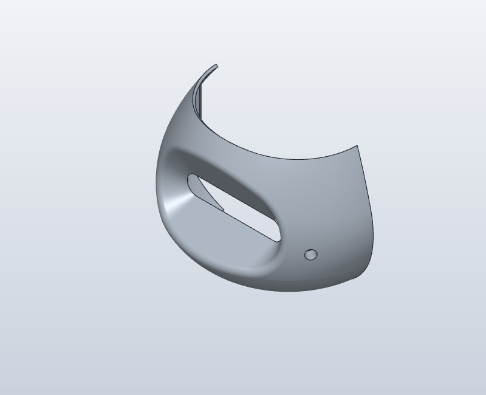
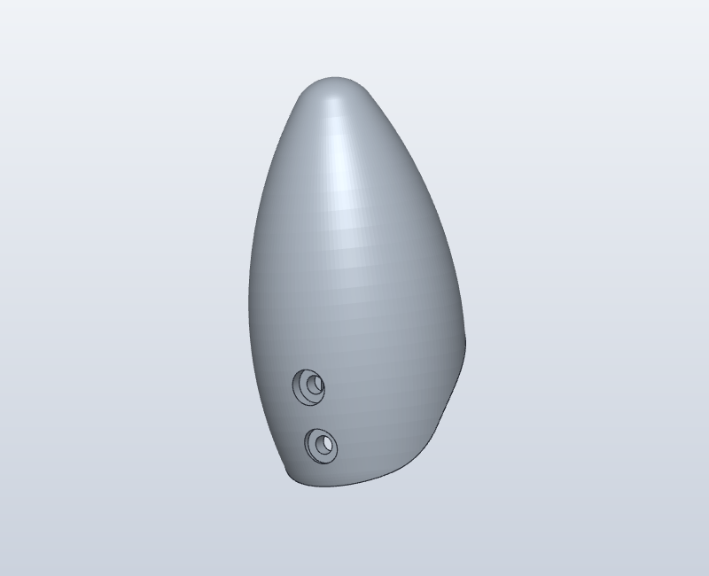
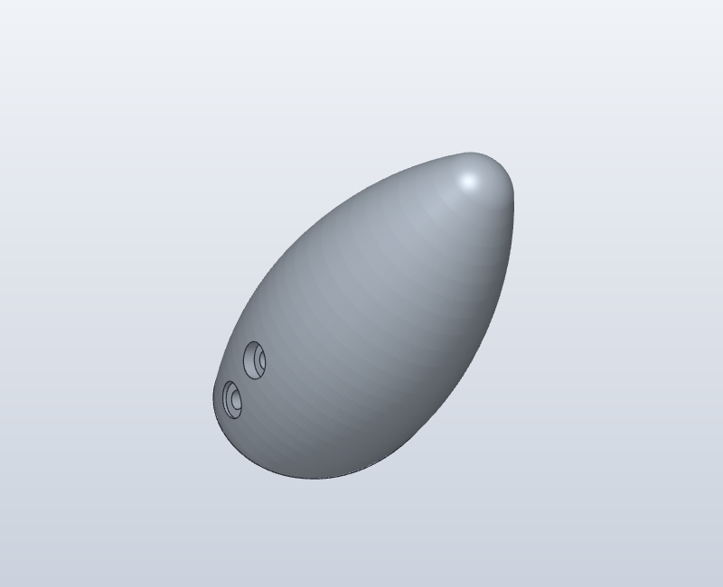
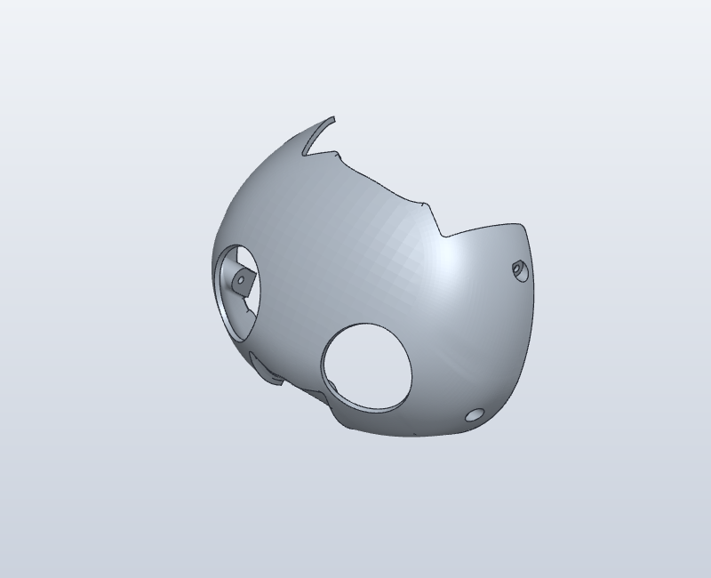
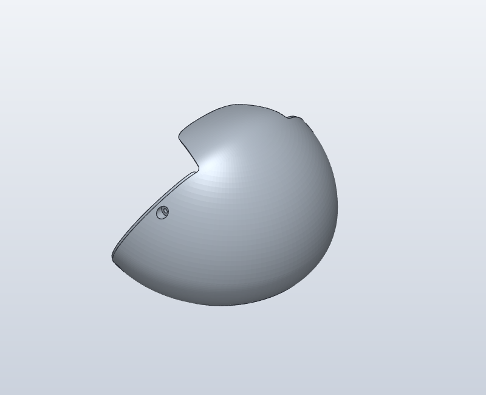
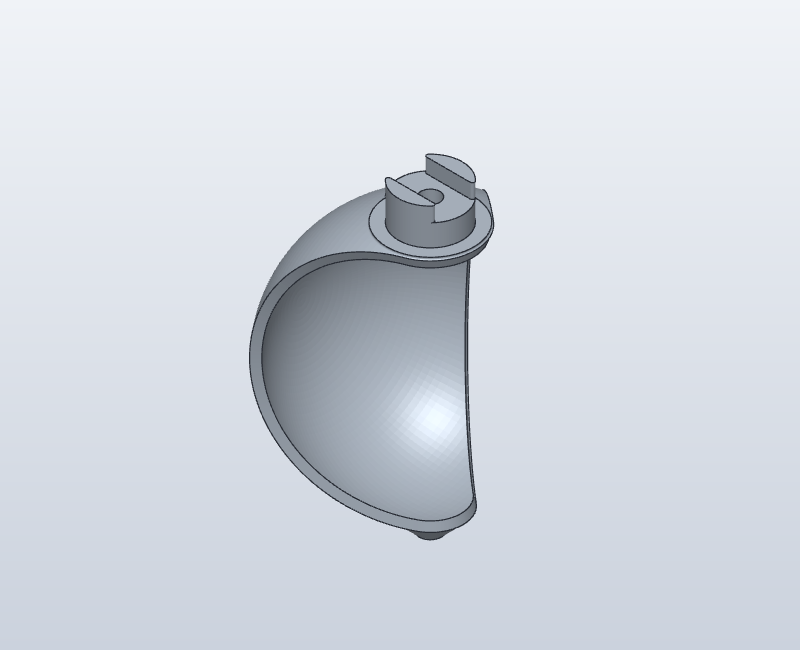
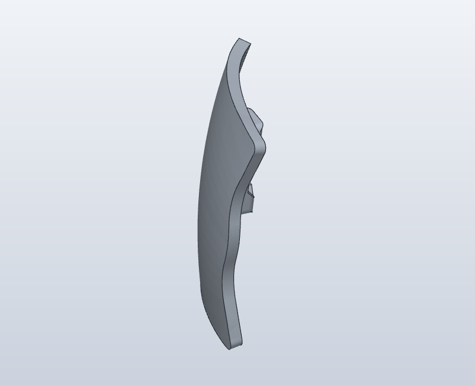
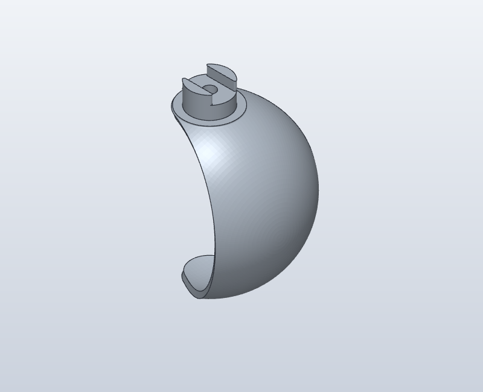
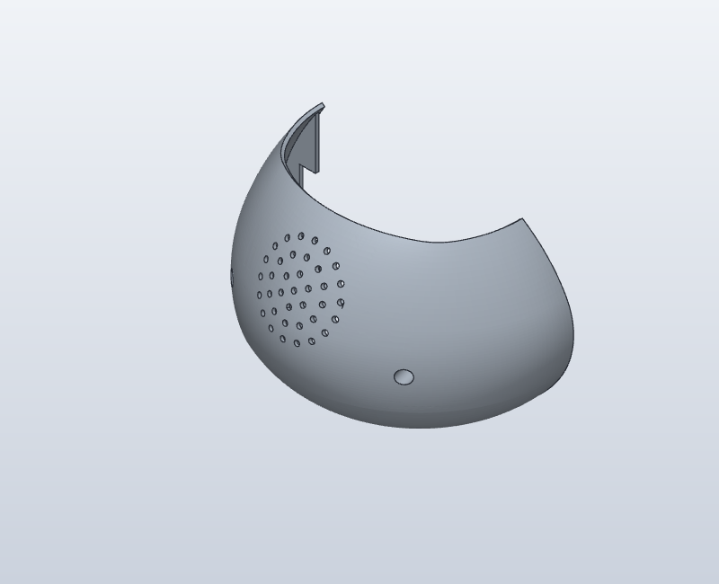

# Plate 2: isolated part views

Derived views of Will Cogley / NMRobotics LTD geometry, CC BY-NC 4.0.
See [upstream provenance](../../UPSTREAM.md). IDs refer to the pinned C0_6_8 pack.
Views are independently fitted, so image sizes cannot be compared as a scale.
Upstream names are preserved. Functional identifications require confirmation.

## C068-O13-P10 — Full (6).stl_2

Mesh-local bounding box: 130.254 × 58.909 × 79.747 mm.

## C068-O13-P11 — NewPlainEars.stl_1

Mesh-local bounding box: 43.893 × 39.109 × 56.616 mm.

## C068-O13-P12 — NewPlainEars.stl_2

Mesh-local bounding box: 43.912 × 39.109 × 56.616 mm.

## C068-O13-P4 — Full.stl_48

Mesh-local bounding box: 129.146 × 61.534 × 81.544 mm.

## C068-O13-P5 — Full.stl_20

Mesh-local bounding box: 129.591 × 81.029 × 90.578 mm.

## C068-O13-P6 — Full.stl_30

Mesh-local bounding box: 42.009 × 26.81 × 23.892 mm.

## C068-O13-P7 — Full.stl_38

Mesh-local bounding box: 22.169 × 19.996 × 35.267 mm.

## C068-O13-P8 — Full.stl_65

Mesh-local bounding box: 42.009 × 26.81 × 23.892 mm.

## C068-O13-P9 — Full (6).stl_1

Mesh-local bounding box: 131.688 × 73.291 × 80.195 mm.

