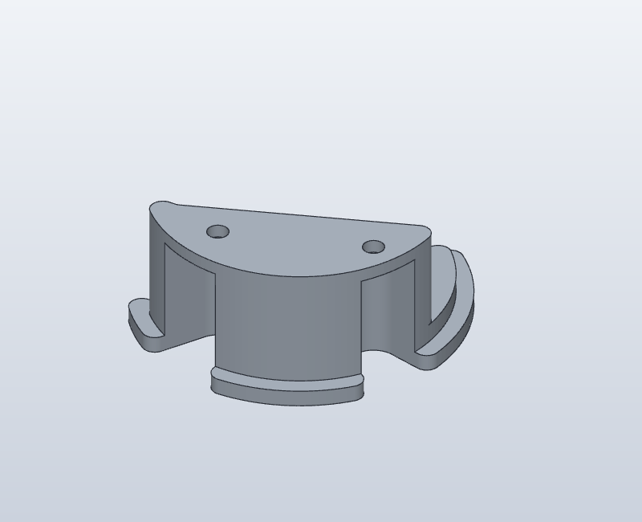
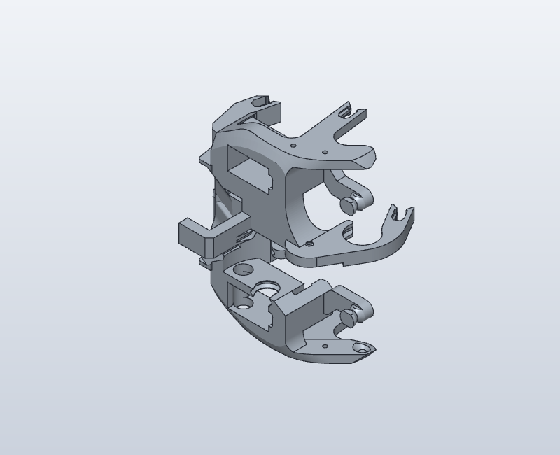
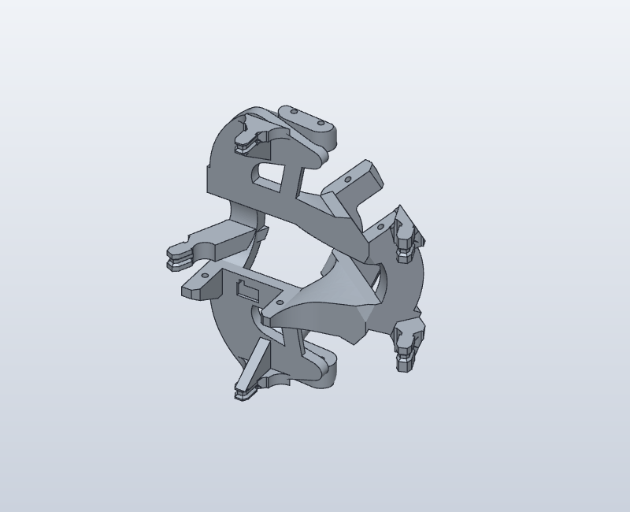
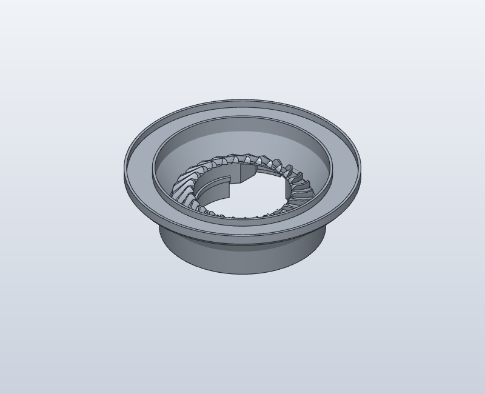
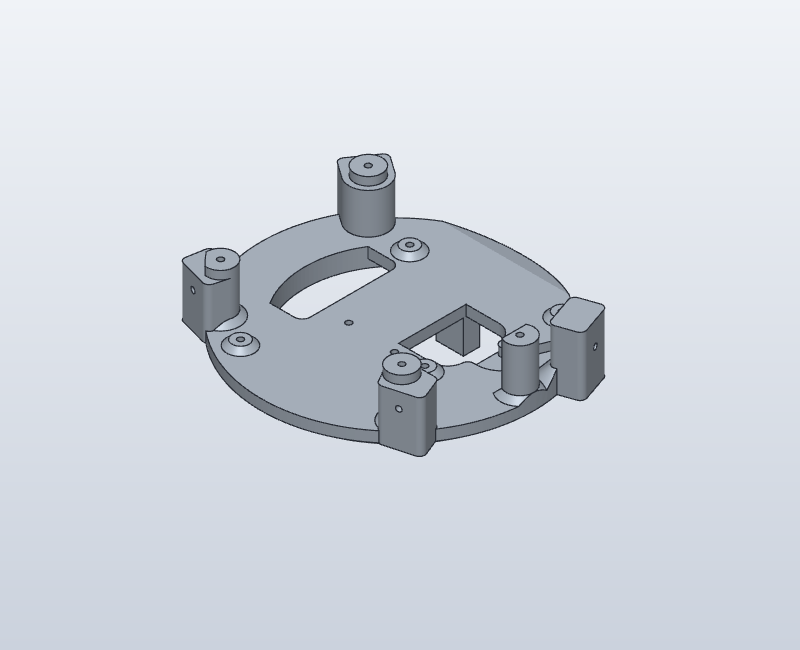
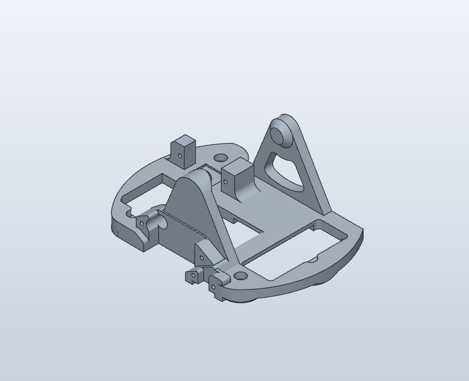

# Structural plate: isolated part views

Derived views of Will Cogley / NMRobotics LTD geometry, CC BY-NC 4.0.
See [upstream provenance](../../UPSTREAM.md). IDs refer to the pinned C0_6_8 pack.
Views are independently fitted, so image sizes cannot be compared as a scale.
Upstream names are preserved. Functional identifications require confirmation.

## C068-O20-P14 — Full - BottomPlug.stl

Mesh-local bounding box: 38.281 × 29.349 × 16.3 mm.

## C068-O20-P15 — Full.stl_7

Mesh-local bounding box: 99.533 × 97.237 × 75.793 mm.

## C068-O20-P16 — Full - Part 24.stl

Mesh-local bounding box: 101.683 × 84.722 × 46.444 mm.

## C068-O20-P17 — Full - Foot (1).stl

Mesh-local bounding box: 92.0 × 92.0 × 27.75 mm.

## C068-O20-P18 — Full (9).stl_3

Mesh-local bounding box: 105.822 × 96.0 × 33.85 mm.

## C068-O20-P19 — Full (9).stl_2

Mesh-local bounding box: 110.964 × 80.808 × 45.999 mm.

